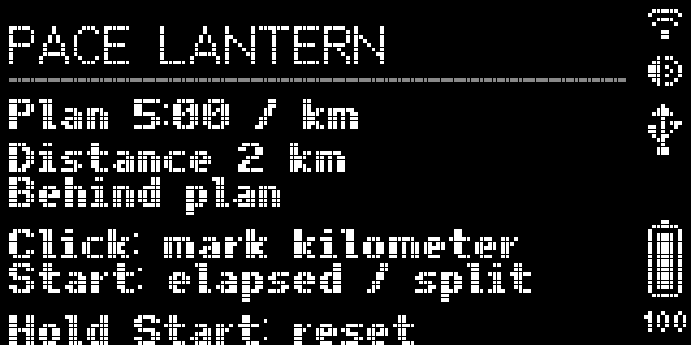

# Pace Lantern

Compare real kilometer crossings against a planned running pace without opening your phone.

Use marked kilometers on a course or a treadmill to check your cumulative pace. The calculation uses the moment you press the button, so a GPS signal or phone connection is unnecessary.

## Screen transitions

Mark a crossing and switch between the pace and elapsed-time readings.


<details>

<summary>Watch the rear display</summary>



</details>

## Mark a kilometer crossing

1. Before starting, turn the wheel to choose a pace per kilometer in five-second steps. Click when the clock should begin.
2. Click once at each complete kilometer. The front compares the crossing time with the planned time for the entire distance covered.
3. Read the sign on **Split vs plan**. A positive value means you are behind. The footage starts during a session and shows the difference changing as crossings are entered.


## Check elapsed time between markers

1. Press **Start** to show the continuously running elapsed time. The switch is visible in the clip.
2. Press **Start** again to return to the difference at the last crossing. Switching pages does not record another kilometer.
3. Hold **Start** after a session to clear the crossing history and reuse the target. Adjust your pace before starting the next run.


## Example from the emulator

At a target of 5:00/km, the plan calls for kilometer three at 15:00. Crossing at 15:12 gives +0:12. The recording uses quick button presses to demonstrate the controls. A missed or extra click changes the recorded distance.

## Run in the emulator

Open BUSY Bar Emulator. From this repository, run:

```sh
~/.busy-emulator/bin/busy-emulator dev --once
```

Press **Back** to exit.

The GIFs are excerpts from the emulator recording. Each LED occupies a 16 × 16 cell with a black border. The end frames pause for reading.

[Full recording](media/controls.mp4) · [Rear display](screenshots/back-1.png) · [Firmware test](EMULATOR-QA.md) · [MIT license](LICENSE)
